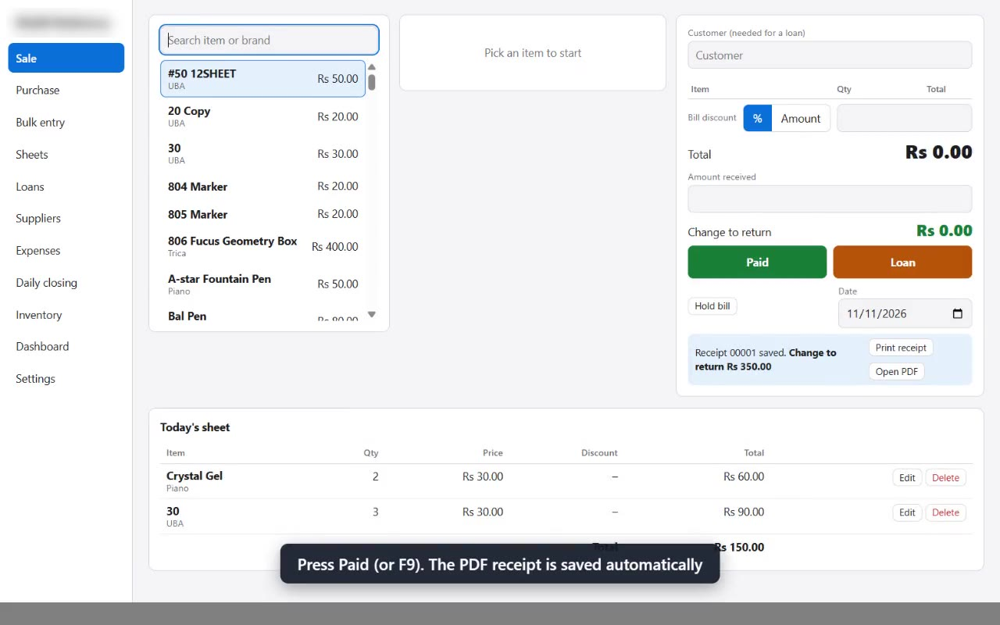

# Stationery Store: retail management in daily production

> **Showcase repository.** The source code is private because it runs a real shop's business. This repo shows what it does and how it's built. I'm happy to walk through the code on a call.

A Windows desktop app that replaced paper registers at a working stationery shop. Staff use it every day for sales, purchases, stock, customer credit (loans) and daily closing.

▶ **[Watch the 2-minute walkthrough](https://sohaibashah.vercel.app/#work)**. The shop name and cost prices are blurred for the owner's privacy.

## What it does

- **Fast counter sales:** search by item or brand, hold bills, apply discounts, calculate change, and print A4 PDF receipts automatically. Also covers printing and photocopy services.
- **Inventory and purchasing:** supplier invoices, box/piece pricing, stock levels, and shopping sheets for re-ordering.
- **Customer credit (loans):** track what each customer owes and record repayments.
- **Daily closing and dashboard:** daily, weekly and monthly figures, expenses, and a day-closing report.
- **Live Excel copy:** every transaction is mirrored to an Excel workbook for the owner.

## Built to survive a shop PC

- **Offline-first SQLite**, with schema migrations on every upgrade, so data survives new versions.
- **30-day rolling backups** plus an **off-site email backup**.
- **Licence keys** and an NSIS installer for clean installs and updates.
- **428 automated tests:** unit tests plus Playwright end-to-end tests that drive the real app against a throwaway database, never the shop's real data.

## Tech stack

Electron · Node.js · SQLite · ExcelJS · Nodemailer · Vitest · Playwright · electron-builder (NSIS)

---

**Syed Sohaib Ali Shah**, Full-Stack & AI Developer · [Portfolio](https://sohaibashah.vercel.app) · [LinkedIn](https://www.linkedin.com/in/sohaibashah/)
